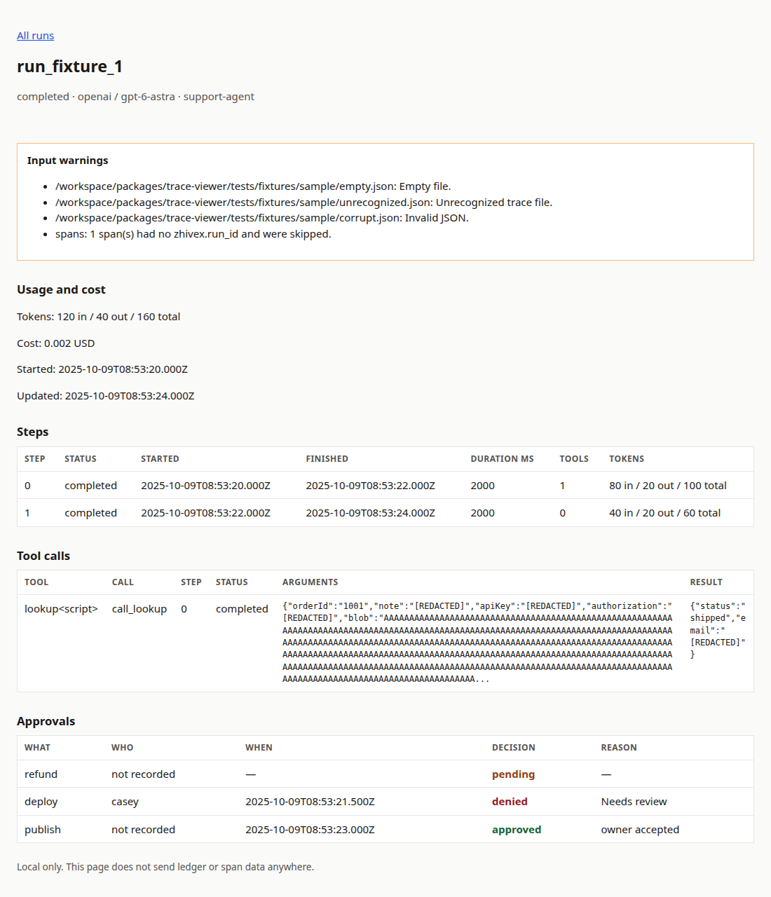
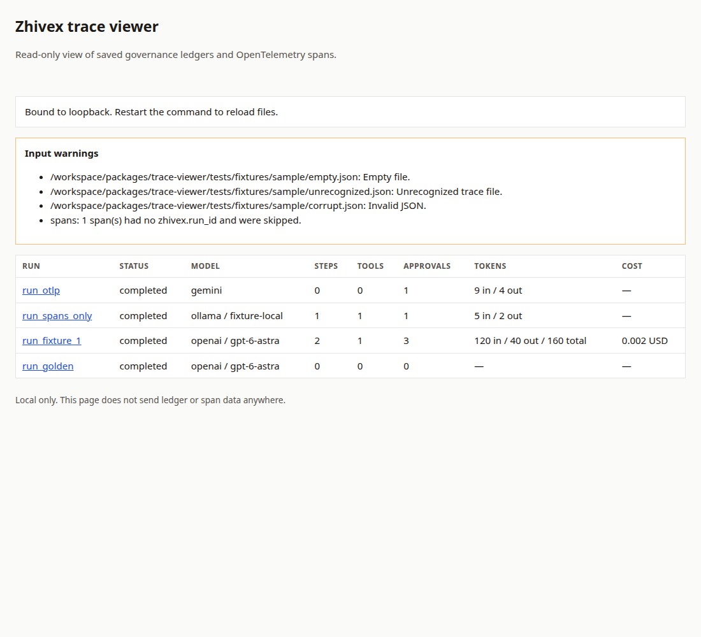

# @zhivex-ai/trace-viewer

Local, read-only viewer for Zhivex governance ledgers and OpenTelemetry spans. It stays out of `@zhivex-ai/sdk` and `@zhivex-ai/core`, so installing it does not change the SDK runtime.

The page lists runs and, for each run, steps, tool calls, approvals, token usage, and cost when those fields are present. It binds to `127.0.0.1` by default and does not make outbound requests.

## Install

```bash
bun add @zhivex-ai/trace-viewer
```

## View a ledger

Point the CLI at a ledger file or a directory of `.json` and `.jsonl` files. `zhivex-ai agents ledger` writes the ledger JSON this viewer reads. Golden traces (`agent_golden_trace`) are unwrapped. OpenTelemetry spans in the same directory are picked up too.

```bash
bunx @zhivex-ai/trace-viewer --ledger ./run-ledger.json
npx @zhivex-ai/trace-viewer --ledger ./.zhivex/ledgers --spans ./.zhivex/spans.jsonl --port 9473
```

From a checkout of this repository:

```bash
bun packages/trace-viewer/src/cli.ts --ledger ./run-ledger.json
```

Then open the printed `http://127.0.0.1:9473/` URL on the same machine. `--host` accepts `127.0.0.1`, `localhost` (bound as `127.0.0.1`), or `::1`. Other addresses are refused. Restart the process to reload files.

## Opt-in span file

The SDK does not write spans to disk. To capture the spans it already emits, add this exporter to a tracer provider you configure yourself. Defaults are unchanged if you skip it.

```ts
import { BasicTracerProvider, SimpleSpanProcessor } from "@opentelemetry/sdk-trace-base";
import { createJsonFileSpanExporter } from "@zhivex-ai/trace-viewer";

const provider = new BasicTracerProvider({
  spanProcessors: [
    new SimpleSpanProcessor(createJsonFileSpanExporter({
      path: ".zhivex/spans.jsonl"
    }))
  ]
});
```

`@opentelemetry/sdk-trace-base` is installed by the application, not by this package. The file is JSONL, mode `0600`, and refuses symlink destinations. Each line keeps the span name, ids, times, attributes, and events. Attribute names such as `zhivex.run_id`, `gen_ai.usage.input_tokens`, and `gen_ai.tool.name` are unchanged. OTLP JSON (`resourceSpans`) is also accepted when reading.

The SDK's OpenTelemetry helpers do not put prompts, tool arguments, or tool results on spans. Those values come from the ledger (`toolAudit`, trace steps, and the optional timeline). Runs are joined on `zhivex.run_id`, including child spans that only point at a parent.

## What a run looks like

```text
run_fixture_1  completed  openai / gpt-6-astra
tokens: 120 in / 40 out / 160 total
cost: 0.002 USD

steps
  0  completed  2000 ms  tools 1  tokens 80 in / 20 out / 100 total
  1  completed  2000 ms  tools 0  tokens 40 in / 20 out / 60 total

tool calls
  lookupOrder  call_lookup  step 0  completed
  arguments: {"orderId":"1001","note":"[REDACTED]","authorization":"[REDACTED]"}
  result: {"status":"shipped","email":"[REDACTED]"}

approvals
  publish  who: not recorded  when: 2025-10-09T08:53:23.000Z  approved
  deploy   who: casey         when: 2025-10-09T08:53:21.500Z  denied
  refund   who: not recorded  when: —                        pending
```

Tool arguments and results are capped at 500 characters. Approval rows show who, what, when, and approved, denied, or pending. "Who" is `not recorded` unless the payload has an approver field such as `metadata.approver` or `zhivex.approver`. The current SDK span events do not include an approver.



The run list shows every loaded run, token totals, cost, and warnings for files that could not be read:



## Redaction

Before anything is rendered or written by the exporter, values are redacted:

- Object keys that match the SDK sensitive-field rule: `apiKey`, `api_key`, `authorization`, `password`, `secret`, `token`, `cookie`, and the same names with camelCase or header spelling, including `approvalToken`.
- Text that matches the SDK rules for `Bearer`, `Basic`, `api_key` / `secret` / `token` assignments, and email addresses (the ledger default).

Usage fields such as `inputTokens` are kept. Redaction does not change the ledger files you already saved.

## Empty and corrupt input

A missing path exits with an error. An empty directory serves a page with no runs. Invalid JSON, empty files, unrecognized JSON, symlinks, and files over 8 MiB are skipped and listed as warnings. One bad file does not hide the valid runs.
